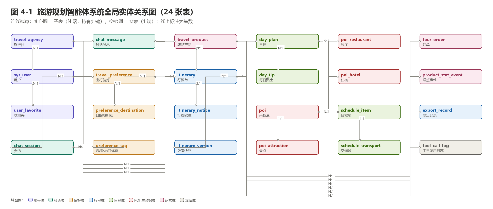
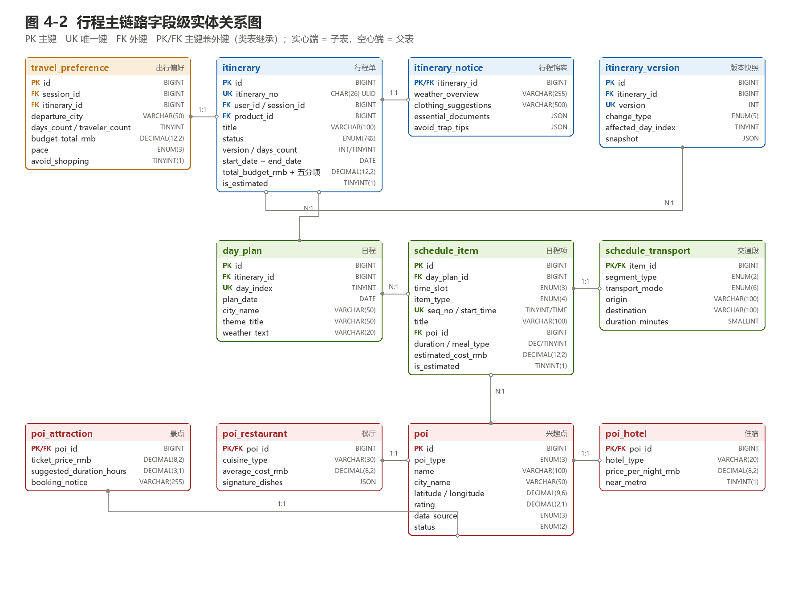

# 3 数据库的命名规则

本章约定 `travel_agent_db` 库中所有数据库对象（库、表、列、索引、约束、枚举值）的命名规则。全部规则在物理设计中已 100% 落地，与 `01_schema.sql` 一一对应。

## 3.1 总则

1. **统一小写 + 下划线分词（snake_case）**：全部对象名只使用小写英文字母、数字与下划线，禁止驼峰、拼音与中文；单词间用单下划线分隔，不出现连续下划线。
2. **见名知义**：优先使用完整英文单词；缩写仅限白名单：`poi`（Point of Interest 兴趣点）、`rmb`（人民币计价）、`no`（number 编号）、`uk/idx/fk/chk`（约束类型前缀）。
3. **规避保留字**：禁止直接使用 MySQL 保留字与过泛词，如 `order`、`user`、`group`；必须使用时叠加域前缀规避（`order → tour_order`，`user → sys_user`）。
4. **与代码层解耦**：数据库层统一 snake_case，后端 TypeScript 接口层的 camelCase 由数据访问层映射，库内不混用两种风格。
5. **语义后缀约定**：布尔 `is_` 前缀；时间戳 `_at`；日期 `_date`；金额 `_rmb`；数量 `_count`；序号 `seq_no` 或 `_index`；业务编号 `_no`；链接 `_url`。
6. **强制注释**：每张表、每个列必须写中文 `COMMENT`，说明业务含义与取值约束；枚举列的取值在注释中收口。

## 3.2 表名规则

表名模式：**`[域前缀_]实体名[_子表语义]`**，一律单数。两条补充规则：

- **核心聚合根不加前缀**：`itinerary`（行程单）、`poi`（兴趣点）是系统的两个聚合根，使用简洁实体名；
- **过泛词必须加域前缀**：`user → sys_user`、`order → tour_order`、`product → travel_product`、`agency → travel_agency`。

表 3-1 域前缀词表

| 前缀 | 所属域 | 示例 |
| --- | --- | --- |
| `sys_` | 系统与账号 | `sys_user` |
| `travel_` | 旅游业务主体（B 端） | `travel_agency`、`travel_product`、`travel_preference` |
| `chat_` | 对话 | `chat_session`、`chat_message` |
| `preference_` | 偏好明细 | `preference_destination`、`preference_tag` |
| `itinerary_` | 行程附属 | `itinerary_notice`、`itinerary_version` |
| `day_` / `schedule_` | 行程内部层级 | `day_plan`、`day_tip`、`schedule_item`、`schedule_transport` |
| `poi_` | POI 子类型（类表继承） | `poi_attraction`、`poi_restaurant`、`poi_hotel` |
| `product_` | 产品统计 | `product_stat_event` |
| `tour_` | 交易 | `tour_order` |
| `tool_` | 工具调用 | `tool_call_log` |
| （无前缀） | 核心聚合根 | `itinerary`、`poi` |

子表/明细表命名 = 父实体名 + 子实体名（`preference_destination`、`day_tip`、`poi_attraction`）；行为记录表命名 = 主体 + 行为/对象（`user_favorite`、`export_record`、`tool_call_log`、`product_stat_event`）。

## 3.3 列名规则

表 3-2 列名规则

| 类别 | 规则 | 示例 |
| --- | --- | --- |
| 主键 | 统一 `id`，`BIGINT UNSIGNED AUTO_INCREMENT` | `id` |
| 对外业务编号 | `<实体>_no`，ULID/订单号 | `itinerary_no`、`order_no`、`product_no` |
| 外键 | `<被引用实体>_id` | `itinerary_id`、`poi_id`、`agency_id` |
| 时间戳 | `<语义>_at` | `created_at`、`confirmed_at`、`paid_at` |
| 日期 | `<语义>_date` | `start_date`、`plan_date` |
| 金额 | `<语义>_rmb`，一律 `DECIMAL` | `total_budget_rmb`、`estimated_cost_rmb` |
| 计数 | `<语义>_count` | `visitor_count`、`message_count` |
| 序号 | `seq_no`（通用）或 `_index`（业务序号） | `seq_no`、`day_index` |
| 布尔 | `is_` / `has_` 前缀 | `is_estimated`、`near_metro`（行业惯用形容词除外） |
| 枚举 | 名词命名，取值全大写下划线 | `status`（DRAFT/PLANNING/…）、`time_slot`（MORNING/…） |

## 3.4 索引与约束命名

表 3-3 索引与约束命名

| 对象 | 模式 | 示例 |
| --- | --- | --- |
| 主键 | 隐式 `PRIMARY KEY(id)` | — |
| 唯一索引 | `uk_<语义>` | `uk_itinerary_no`、`uk_day_itinerary_index` |
| 普通索引 | `idx_<表语义>_<列语义>` | `idx_itinerary_user`、`idx_message_session` |
| 外键 | `fk_<子表语义>_<父表语义>` | `fk_item_day`、`fk_order_product` |
| CHECK 约束 | `chk_<表语义>_<语义>` | `chk_itin_budget_ceiling`、`chk_pref_days` |

## 3.5 现有对象命名对照

表 3-4 现有 24 张表的命名依据

| 表名 | 命名构成 | 规则依据 |
| --- | --- | --- |
| `travel_agency` | travel + agency | B 端租户主体，旅游业务域前缀 |
| `sys_user` | sys + user | user 为保留字且语义过宽，加系统域前缀 |
| `user_favorite` | user + favorite | 用户行为记录 = 主体 + 行为名词 |
| `chat_session` | chat + session | 对话域前缀 + 实体名 |
| `chat_message` | chat + message | 与 chat_session 同域，前缀一致 |
| `poi` | poi | 核心聚合根 + 行业通用缩写（白名单） |
| `poi_attraction` | poi + attraction | 类表继承子类型表：父实体 + 子类型 |
| `poi_restaurant` | poi + restaurant | 类表继承子类型表：父实体 + 子类型 |
| `poi_hotel` | poi + hotel | 类表继承子类型表：父实体 + 子类型 |
| `travel_product` | travel + product | product 语义过宽，加旅游业务域前缀 |
| `itinerary` | itinerary | 核心聚合根，使用简洁实体名 |
| `itinerary_notice` | itinerary + notice | 行程 1:1 锦囊，垂直拆分子表 |
| `travel_preference` | travel + preference | preference 语义过宽，加域前缀 |
| `preference_destination` | 父实体 + 子实体 | 偏好多值属性明细：目的地 |
| `preference_tag` | 父实体 + 子实体 | 偏好多值属性明细：兴趣/忌口 |
| `day_plan` | day + plan | 行程内部天粒度实体 |
| `day_tip` | day + tip | 日程贴士明细：父实体 + 内容 |
| `schedule_item` | schedule + item | 日程项，统一承载四类日程 |
| `schedule_transport` | schedule + transport | 日程项交通专有扩展（1:1 垂直拆分） |
| `itinerary_version` | itinerary + version | 行程版本快照 |
| `export_record` | export + record | 导出行为记录表 |
| `product_stat_event` | product + stat + event | 产品域统计埋点事件明细 |
| `tour_order` | tour + order | order 为 SQL 保留字，加交易域前缀规避 |
| `tool_call_log` | tool + call + log | 五大工具调用日志 |

表 3-5 代表性列命名对照

| 列名 | 所在表 | 规则依据 |
| --- | --- | --- |
| `id` | 全部表 | 主键统一命名 |
| `itinerary_no` | itinerary | 对外业务编号 `_no`，ULID |
| `user_id / agency_id / poi_id` | 多表 | 外键 = 被引用实体 `_id` |
| `total_budget_rmb` | itinerary | 金额 `_rmb`，DECIMAL(12,2) |
| `estimated_cost_rmb` | schedule_item | 金额 `_rmb`，DECIMAL(12,2) |
| `is_estimated` | itinerary / schedule_item / poi | 布尔 `is_` 前缀 |
| `visitor_count / order_count` | travel_product | 计数 `_count` |
| `seq_no / day_index` | schedule_item / day_plan | 序号 `seq_no` 与业务序号 `_index` |
| `confirmed_at / exported_at` | itinerary | 状态迁移时间戳 `_at` |
| `start_date / plan_date` | itinerary / day_plan | 日期 `_date` |
| `created_at / updated_at` | 全部表 | 审计时间戳统一词对 |

# 4 逻辑设计

本章将需求分析文档第 4 章领域类图映射为实体关系模型。映射策略共五条：

1. **一个类映射为一张表**，类的属性映射为列，类的标识映射为主键；
2. **组合关系（◆）**映射为强关联外键并 `ON DELETE CASCADE`：`itinerary ◆ day_plan ◆ schedule_item` 三级，行程删除则日程与日程项级联删除；
3. **继承关系（▷）**采用类表继承：`poi` 存公共属性，`poi_attraction / poi_restaurant / poi_hotel` 三张子表以主键即外键的方式挂接，对应类图中 Attraction / Restaurant / Hotel 对 POI 的泛化；
4. **多值属性**拆为子表以满足第一范式：`destinationCities[] → preference_destination`，`interests[] / dietaryRestrictions[] → preference_tag`；纯展示型数组（招牌菜、防坑提示）保留 JSON；
5. **1:1 大字段垂直拆分**：锦囊 `essentialKitAndNotices` 拆为 `itinerary_notice`，交通专有属性拆为 `schedule_transport`，避免主表过宽。

## 4.1 全局实体关系图

- **八域组织**：24 张表划分为账号、对话、偏好、行程、日程、POI 主数据、运营与支撑八个域；
- **连线约定**：实心圆 = 子表（N 端，持有外键），空心圆 = 父表（1 端），线上标注基数；
- **依赖方向**：自左向右——会话提取偏好 → 生成行程 → 展开日程与日程项 → 引用 POI 主数据；B 端产品、订单与埋点挂在行程与机构之上。

## 4.2 行程主链路字段级关系图

- **主链路**：`travel_preference`（1:1）落到 `itinerary`，行程按天展开为 `day_plan`，天再展开为 `schedule_item`（时段 × 类型 × 序号唯一）；
- **交通拆分**：交通项 1:1 垂直拆分出 `schedule_transport`，主表保持精简；
- **POI 继承**：景点/餐厅/酒店统一引用 `poi` 主数据，三个子类型表以 `poi_id` 主键即外键实现继承；
- **附属结构**：`itinerary_notice` 与 `itinerary_version` 分别承担锦囊与版本快照。

## 4.3 实体关系一览

表 4-1 列出数据库中全部 35 个外键关系及 2 个应用层维护的逻辑关联。基数判定：子表外键列为主键或单列唯一索引时为 1:1，否则为 N:1。

表 4-1 实体关系一览

| 序号 | 子表（N 端） | 外键列 | 父表（1 端） | 基数 | 删除策略 |
| --- | --- | --- | --- | --- | --- |
| 1 | `sys_user` | `agency_id` | `travel_agency` | N:1 | 限制删除（NO ACTION） |
| 2 | `user_favorite` | `user_id` | `sys_user` | N:1 | 级联删除 |
| 3 | `chat_session` | `user_id` | `sys_user` | N:1 | 置空 |
| 4 | `chat_message` | `itinerary_id` | `itinerary` | N:1 | 置空 |
| 5 | `chat_message` | `session_id` | `chat_session` | N:1 | 级联删除 |
| 6 | `poi_attraction` | `poi_id` | `poi` | 1:1 | 级联删除 |
| 7 | `poi_restaurant` | `poi_id` | `poi` | 1:1 | 级联删除 |
| 8 | `poi_hotel` | `poi_id` | `poi` | 1:1 | 级联删除 |
| 9 | `travel_product` | `agency_id` | `travel_agency` | N:1 | 限制删除 |
| 10 | `travel_product` | `created_by` | `sys_user` | N:1 | 置空 |
| 11 | `itinerary` | `product_id` | `travel_product` | N:1 | 置空 |
| 12 | `itinerary` | `session_id` | `chat_session` | N:1 | 置空 |
| 13 | `itinerary` | `user_id` | `sys_user` | N:1 | 置空 |
| 14 | `itinerary_notice` | `itinerary_id` | `itinerary` | 1:1 | 级联删除 |
| 15 | `travel_preference` | `itinerary_id` | `itinerary` | 1:1 | 置空 |
| 16 | `travel_preference` | `session_id` | `chat_session` | N:1 | 置空 |
| 17 | `preference_destination` | `preference_id` | `travel_preference` | N:1 | 级联删除 |
| 18 | `preference_tag` | `preference_id` | `travel_preference` | N:1 | 级联删除 |
| 19 | `day_plan` | `itinerary_id` | `itinerary` | N:1 | 级联删除 |
| 20 | `day_tip` | `day_plan_id` | `day_plan` | N:1 | 级联删除 |
| 21 | `schedule_item` | `day_plan_id` | `day_plan` | N:1 | 级联删除 |
| 22 | `schedule_item` | `poi_id` | `poi` | N:1 | 限制删除（NO ACTION） |
| 23 | `schedule_transport` | `item_id` | `schedule_item` | 1:1 | 级联删除 |
| 24 | `itinerary_version` | `itinerary_id` | `itinerary` | N:1 | 级联删除 |
| 25 | `itinerary_version` | `created_by` | `sys_user` | N:1 | 置空 |
| 26 | `export_record` | `itinerary_id` | `itinerary` | N:1 | 级联删除 |
| 27 | `export_record` | `user_id` | `sys_user` | N:1 | 置空 |
| 28 | `product_stat_event` | `itinerary_id` | `itinerary` | N:1 | 置空 |
| 29 | `product_stat_event` | `product_id` | `travel_product` | N:1 | 级联删除 |
| 30 | `product_stat_event` | `user_id` | `sys_user` | N:1 | 置空 |
| 31 | `tour_order` | `itinerary_id` | `itinerary` | N:1 | 置空 |
| 32 | `tour_order` | `product_id` | `travel_product` | N:1 | 置空 |
| 33 | `tour_order` | `user_id` | `sys_user` | N:1 | 限制删除 |
| 34 | `tool_call_log` | `itinerary_id` | `itinerary` | N:1 | 置空 |
| 35 | `tool_call_log` | `session_id` | `chat_session` | N:1 | 置空 |
| 36 | `user_favorite` | `target_type + target_id` | `itinerary / poi / travel_product` | N:1 | 多态关联，应用层保证（无外键） |
| 37 | `product_stat_event` | `order_id` | `tour_order` | N:1 | 逻辑关联，应用层保证（无外键） |

## 4.4 类图到表的映射说明

表 4-2 关键设计映射

| 类图元素 | 表实现 | 设计理由 |
| --- | --- | --- |
| `TravelPlanItinerary ◆ DayPlan ◆ ScheduleItem` 组合 | `itinerary → day_plan → schedule_item` 三级外键，`ON DELETE CASCADE` | 行程销毁则日程随之销毁，生命周期一致 |
| `Attraction / Restaurant / Hotel ▷ POI` 继承 | `poi` + 三张 `poi_*` 子表（主键即外键） | 公共属性（经纬度/评分）复用，专有属性隔离；子表主键即外键保证 1:1 |
| `ScheduleItem` 用 `itemType + timeSlot` 统一表达 | `schedule_item` 单表 + `item_type` 判别列 + CHECK 约束 | 类型判别字段少、整天数据一次读取；交通专有字段再拆 `schedule_transport` |
| `UserTravelPreference` 多值属性 | `preference_destination`、`preference_tag` 子表 | 满足 1NF，可排序、可按标签统计；`raw_input` 保留原始话术可追溯 |
| `BudgetAllocation` 值对象 | `itinerary` 内 5 个 `_rmb` 列 + CHECK 总额校验 | 分项比例固定（30/35/15/15/5），是同生命周期值对象，不独立成表 |
| `EssentialKitAndNotices` 锦囊 | `itinerary_notice`（1:1 垂直拆分） | 仅详情/导出场景读取，主表保持精简 |
| 版本管理（`version` 只增不减） | `itinerary_version` 快照表，`(itinerary_id, version)` 唯一 | 支撑「第 2 天变了其他天不变」的验收与幂等 |
| `TravelProduct ─ TravelPlanItinerary` 0..1 关联 | `itinerary.product_id` 可空外键 | 模板生成与自由对话生成两种来源并存 |

# 5 物理设计

## 5.0 物理环境参数

- **数据库系统**：MySQL 8.0（≥8.0.16，CHECK 约束生效）；**存储引擎**：InnoDB（事务 + 行锁 + 外键）；
- **字符集 / 排序规则**：`utf8mb4` / `utf8mb4_0900_ai_ci`（支持中文与 emoji 图标）；
- **主键策略**：内部 `BIGINT UNSIGNED AUTO_INCREMENT`；对外业务编号 `itinerary_no` 为 26 位 ULID（`CHAR(26) ascii_bin`），支持离线生成与幂等；
- **金额精度**：一律 `DECIMAL`（总额 `DECIMAL(12,2)`，单价 `DECIMAL(8,2)`），禁止 FLOAT/DOUBLE；
- **经纬度精度**：`DECIMAL(9,6)`，满足动线顺路计算误差要求；
- **大字段**：快照与数组类（`snapshot`、`avoid_trap_tips` 等）使用 JSON；导出内容快照使用 `MEDIUMTEXT`。

## 5.1 表汇总

表 5-1 数据表汇总（24 张）

| 序号 | 表名 | 说明 |
| --- | --- | --- |
| 1 | `travel_agency` | 旅行社（B 端租户），线路产品的归属主体 |
| 2 | `sys_user` | 系统用户 |
| 3 | `user_favorite` | 收藏夹 |
| 4 | `chat_session` | 对话会话 |
| 5 | `chat_message` | 对话消息 |
| 6 | `poi` | 兴趣点主表（景点/餐厅/酒店公共属性），对应类图 POI 抽象类 |
| 7 | `poi_attraction` | 景点扩展表，对应类图 Attraction |
| 8 | `poi_restaurant` | 餐厅扩展表，对应类图 Restaurant |
| 9 | `poi_hotel` | 住宿扩展表，对应类图 Hotel |
| 10 | `travel_product` | 线路产品 TravelProduct |
| 11 | `itinerary` | 行程单（核心实体），组合根 |
| 12 | `itinerary_notice` | 行程锦囊 EssentialKitAndNotices |
| 13 | `travel_preference` | 出行偏好 UserTravelPreference |
| 14 | `preference_destination` | 目的地城市明细 |
| 15 | `preference_tag` | 兴趣与忌口标签 |
| 16 | `day_plan` | 日程 DayPlan |
| 17 | `day_tip` | 每日贴士 |
| 18 | `schedule_item` | 日程项 ScheduleItem |
| 19 | `schedule_transport` | 交通段扩展表 TransportSegment |
| 20 | `itinerary_version` | 行程版本快照 |
| 21 | `export_record` | 导出记录 ExportRecord |
| 22 | `product_stat_event` | 埋点事件明细 |
| 23 | `tour_order` | 订单 |
| 24 | `tool_call_log` | 工具调用日志 |

## 5.2 表设计

以下 24 张表的结构明细由数据库 `information_schema` 直接导出，与 `01_schema.sql` 完全一致。「长度」列：字符类型为最大字符数，`DECIMAL` 为（精度,标度），枚举与整型不适用填「—」，枚举取值在注释中给出。

### 表 5-2 travel_agency（旅行社）

| 列名 | 数据类型 | 长度 | 为空 | 主键 | 注释 |
| --- | --- | --- | --- | --- | --- |
| `id` | BIGINT UNSIGNED | — | 否 | 是 | 主键 |
| `agency_name` | VARCHAR | 100 | 否 |  | 旅行社名称 |
| `license_no` | VARCHAR | 50 | 否 |  | 旅行社业务经营许可证号 |
| `contact_name` | VARCHAR | 50 | 是 |  | 联系人 |
| `contact_phone` | VARCHAR | 20 | 是 |  | 联系电话 |
| `status` | ENUM | — | 否 |  | 机构状态；取值：ACTIVE/DISABLED |
| `created_at` | DATETIME | — | 否 |  | 创建时间，默认当前时间 |
| `updated_at` | DATETIME | — | 否 |  | 更新时间，默认当前时间，自动更新 |

### 表 5-3 sys_user（系统用户）

| 列名 | 数据类型 | 长度 | 为空 | 主键 | 注释 |
| --- | --- | --- | --- | --- | --- |
| `id` | BIGINT UNSIGNED | — | 否 | 是 | 主键 |
| `agency_id` | BIGINT UNSIGNED | — | 是 |  | 外键→`travel_agency.id`；所属旅行社；C 端游客为 NULL |
| `username` | VARCHAR | 50 | 否 |  | 登录名 |
| `password_hash` | VARCHAR | 100 | 否 |  | bcrypt 哈希，禁止明文 |
| `nickname` | VARCHAR | 50 | 是 |  | 昵称 |
| `phone` | VARCHAR | 20 | 是 |  | 手机号（导出内容需脱敏） |
| `avatar_url` | VARCHAR | 512 | 是 |  | 头像地址 |
| `role` | ENUM | — | 否 |  | 角色；取值：TOURIST/ADMIN |
| `default_departure_city` | VARCHAR | 50 | 是 |  | 常用出发城市，用于偏好预填 |
| `status` | ENUM | — | 否 |  | 账号状态；取值：ACTIVE/DISABLED |
| `last_login_at` | DATETIME | — | 是 |  | 最近登录时间 |
| `created_at` | DATETIME | — | 否 |  | 创建时间，默认当前时间 |
| `updated_at` | DATETIME | — | 否 |  | 更新时间，默认当前时间，自动更新 |

### 表 5-4 user_favorite（收藏夹）

| 列名 | 数据类型 | 长度 | 为空 | 主键 | 注释 |
| --- | --- | --- | --- | --- | --- |
| `id` | BIGINT UNSIGNED | — | 否 | 是 | 主键 |
| `user_id` | BIGINT UNSIGNED | — | 否 |  | 外键→`sys_user.id`；收藏人 |
| `target_type` | ENUM | — | 否 |  | 收藏对象类型；取值：ITINERARY/POI/PRODUCT |
| `target_id` | BIGINT UNSIGNED | — | 否 |  | 收藏对象主键（多态关联，不加外键） |
| `created_at` | DATETIME | — | 否 |  | 收藏时间，默认当前时间 |

### 表 5-5 chat_session（对话会话）

| 列名 | 数据类型 | 长度 | 为空 | 主键 | 注释 |
| --- | --- | --- | --- | --- | --- |
| `id` | BIGINT UNSIGNED | — | 否 | 是 | 主键 |
| `user_id` | BIGINT UNSIGNED | — | 是 |  | 外键→`sys_user.id`；所属游客；NULL 表示未登录的体验会话 |
| `title` | VARCHAR | 100 | 否 |  | 会话标题（取首句需求） |
| `status` | ENUM | — | 否 |  | 会话状态；取值：ACTIVE/CLOSED |
| `message_count` | INT UNSIGNED | — | 否 |  | 消息条数（冗余计数，便于列表展示） |
| `last_active_at` | DATETIME | — | 否 |  | 最后活跃时间，默认当前时间 |
| `created_at` | DATETIME | — | 否 |  | 创建时间，默认当前时间 |
| `updated_at` | DATETIME | — | 否 |  | 更新时间，默认当前时间，自动更新 |

### 表 5-6 chat_message（对话消息）

| 列名 | 数据类型 | 长度 | 为空 | 主键 | 注释 |
| --- | --- | --- | --- | --- | --- |
| `id` | BIGINT UNSIGNED | — | 否 | 是 | 主键 |
| `session_id` | BIGINT UNSIGNED | — | 否 |  | 外键→`chat_session.id`；所属会话 |
| `sender` | ENUM | — | 否 |  | 发送方；取值：USER/ASSISTANT/SYSTEM |
| `content` | MEDIUMTEXT | — | 否 |  | 消息正文（LLM 原始输出，便于回溯） |
| `itinerary_id` | BIGINT UNSIGNED | — | 是 |  | 外键→`itinerary.id`；关联行程单（0..1） |
| `intent_tags` | JSON | — | 是 |  | 语义标签，如 ["亲子","慢节奏"] |
| `tool_tags` | JSON | — | 是 |  | 本轮调用的工具，如 ["WEATHER","FOOD"] |
| `token_count` | INT UNSIGNED | — | 是 |  | token 消耗，用于成本核算 |
| `created_at` | DATETIME | — | 否 |  | 发送时间，默认当前时间 |

### 表 5-7 poi（兴趣点主表）

| 列名 | 数据类型 | 长度 | 为空 | 主键 | 注释 |
| --- | --- | --- | --- | --- | --- |
| `id` | BIGINT UNSIGNED | — | 否 | 是 | 主键 |
| `poi_type` | ENUM | — | 否 |  | POI 类型（继承判别列）；取值：ATTRACTION/RESTAURANT/HOTEL |
| `name` | VARCHAR | 100 | 否 |  | 名称 |
| `city_name` | VARCHAR | 50 | 否 |  | 所在城市 |
| `district` | VARCHAR | 50 | 是 |  | 行政区 |
| `address` | VARCHAR | 255 | 是 |  | 详细地址 |
| `latitude` | DECIMAL | 9,6 | 否 |  | 纬度（动线顺路计算核心输入） |
| `longitude` | DECIMAL | 9,6 | 否 |  | 经度 |
| `rating` | DECIMAL | 2,1 | 是 |  | 评分 0.0-5.0，来源高德 |
| `tel` | VARCHAR | 30 | 是 |  | 联系电话 |
| `opening_hours` | VARCHAR | 100 | 是 |  | 开放/营业时间 |
| `cover_image_url` | VARCHAR | 512 | 是 |  | 封面图 |
| `source_poi_id` | VARCHAR | 64 | 是 |  | 外部数据源 POI 编号（高德），用于增量同步去重 |
| `data_source` | ENUM | — | 否 |  | 数据来源；取值：AMAP/MOCK/MANUAL |
| `is_estimated` | TINYINT | 1 | 否 |  | 是否为估算数据（MOCK 强制为 1） |
| `status` | ENUM | — | 否 |  | 上下架状态；POI 只下架不物理删除，保护历史行程；取值：ACTIVE/OFFLINE |
| `created_at` | DATETIME | — | 否 |  | 创建时间，默认当前时间 |
| `updated_at` | DATETIME | — | 否 |  | 更新时间，默认当前时间，自动更新 |

### 表 5-8 poi_attraction（景点扩展表）

| 列名 | 数据类型 | 长度 | 为空 | 主键 | 注释 |
| --- | --- | --- | --- | --- | --- |
| `poi_id` | BIGINT UNSIGNED | — | 否 | 是 | 外键→`poi.id`；主键兼外键，指向 poi.id |
| `ticket_price_rmb` | DECIMAL | 8,2 | 否 |  | 门票价格（元）；0 表示免费 |
| `suggested_duration_hours` | DECIMAL | 3,1 | 否 |  | 建议游玩时长（小时） |
| `booking_notice` | VARCHAR | 255 | 是 |  | 预约须知，如「提前在公众号预约」 |
| `category_tag` | VARCHAR | 30 | 是 |  | 景点分类：自然风光/人文古迹/主题乐园 |
| `best_visit_time` | VARCHAR | 50 | 是 |  | 最佳游览时段 |

### 表 5-9 poi_restaurant（餐厅扩展表）

| 列名 | 数据类型 | 长度 | 为空 | 主键 | 注释 |
| --- | --- | --- | --- | --- | --- |
| `poi_id` | BIGINT UNSIGNED | — | 否 | 是 | 外键→`poi.id`；主键兼外键，指向 poi.id |
| `cuisine_type` | VARCHAR | 30 | 是 |  | 菜系：滇菜/川菜/火锅/小吃 |
| `average_cost_rmb` | DECIMAL | 8,2 | 否 |  | 人均消费（元） |
| `signature_dishes` | JSON | — | 是 |  | 招牌菜数组，如 ["松茸土鸡汤","包浆豆腐"] |
| `business_hours` | VARCHAR | 100 | 是 |  | 营业时间 |
| `has_private_room` | TINYINT | 1 | 否 |  | 是否有包间（家庭游加权项） |

### 表 5-10 poi_hotel（住宿扩展表）

| 列名 | 数据类型 | 长度 | 为空 | 主键 | 注释 |
| --- | --- | --- | --- | --- | --- |
| `poi_id` | BIGINT UNSIGNED | — | 否 | 是 | 外键→`poi.id`；主键兼外键，指向 poi.id |
| `hotel_type` | VARCHAR | 20 | 是 |  | 住宿类型：星级酒店/精品客栈/民宿 |
| `star_level` | TINYINT UNSIGNED | — | 是 |  | 星级 1-5；民宿可为空 |
| `price_per_night_rmb` | DECIMAL | 8,2 | 否 |  | 参考每晚价格（元） |
| `near_metro` | TINYINT | 1 | 否 |  | 是否近地铁（true 时推荐排序加权） |
| `key_features` | JSON | — | 是 |  | 特色标签，如 ["近地铁","含早餐"] |
| `check_in_time` | TIME | — | 是 |  | 最早入住时间 |

### 表 5-11 travel_product（线路产品 TravelProduct）

| 列名 | 数据类型 | 长度 | 为空 | 主键 | 注释 |
| --- | --- | --- | --- | --- | --- |
| `id` | BIGINT UNSIGNED | — | 否 | 是 | 主键 |
| `product_no` | VARCHAR | 32 | 否 |  | 产品编号，如 prod_001 |
| `agency_id` | BIGINT UNSIGNED | — | 否 |  | 外键→`travel_agency.id`；所属旅行社 |
| `title` | VARCHAR | 100 | 否 |  | 线路名称 |
| `destination` | VARCHAR | 100 | 否 |  | 目的地（可含多城，如「四川/西藏」） |
| `default_days` | TINYINT UNSIGNED | — | 否 |  | 默认天数 |
| `style_tag` | VARCHAR | 30 | 是 |  | 风格标签，如「休闲慢节奏」 |
| `base_price_rmb` | DECIMAL | 12,2 | 否 |  | 基准价（元/人） |
| `cover_image_url` | VARCHAR | 512 | 是 |  | 封面图 |
| `description` | TEXT | — | 是 |  | 产品详情 |
| `status` | ENUM | — | 否 |  | 状态机：新建/已上架/已下架；取值：DRAFT/ON_SALE/OFF_SALE |
| `is_active` | TINYINT | 1 | 是 |  | 是否上架（派生列，兼容前端 isActive） |
| `visitor_count` | INT UNSIGNED | — | 否 |  | 访客数（埋点汇总） |
| `plans_generated_count` | INT UNSIGNED | — | 否 |  | 生成行程数（埋点汇总） |
| `order_count` | INT UNSIGNED | — | 否 |  | 下单数（埋点汇总） |
| `conversion_rate` | DECIMAL | 5,4 | 是 |  | 转化率 = 下单数/访客数，只读派生列，保留 4 位小数 |
| `created_by` | BIGINT UNSIGNED | — | 是 |  | 外键→`sys_user.id`；创建人（管理员） |
| `created_at` | DATETIME | — | 否 |  | 创建时间，默认当前时间 |
| `updated_at` | DATETIME | — | 否 |  | 更新时间，默认当前时间，自动更新 |

### 表 5-12 itinerary（行程单）

| 列名 | 数据类型 | 长度 | 为空 | 主键 | 注释 |
| --- | --- | --- | --- | --- | --- |
| `id` | BIGINT UNSIGNED | — | 否 | 是 | 自增主键，供内部关联 |
| `itinerary_no` | CHAR | 26 | 否 |  | 对外业务编号（ULID），对应类图 itineraryId |
| `user_id` | BIGINT UNSIGNED | — | 是 |  | 外键→`sys_user.id`；所属游客；NULL 为未登录行程 |
| `session_id` | BIGINT UNSIGNED | — | 是 |  | 外键→`chat_session.id`；产生该行程的会话 |
| `product_id` | BIGINT UNSIGNED | — | 是 |  | 外键→`travel_product.id`；由哪个线路模板生成；自由对话生成为 NULL |
| `title` | VARCHAR | 100 | 否 |  | 行程标题 planTitle |
| `summary` | VARCHAR | 500 | 是 |  | 一句话简介 summaryDescription |
| `status` | ENUM | — | 否 |  | 状态机 7 态，只能按 5.1 状态表迁移；取值：DRAFT/PLANNING/PENDING_CONFIRM/OPTIMIZING/CONFIRMED/EXPORTED/ARCHIVED |
| `version` | INT UNSIGNED | — | 否 |  | 版本号，每次优化 +1，只增不减 |
| `days_count` | TINYINT UNSIGNED | — | 否 |  | 总天数 |
| `nights_count` | TINYINT UNSIGNED | — | 否 |  | 总晚数 |
| `start_date` | DATE | — | 是 |  | 出发日期 |
| `end_date` | DATE | — | 是 |  | 结束日期 |
| `total_budget_rmb` | DECIMAL | 12,2 | 否 |  | 预算总额（元） |
| `budget_transportation_rmb` | DECIMAL | 12,2 | 否 |  | 交通预算，默认总预算×30% |
| `budget_accommodation_rmb` | DECIMAL | 12,2 | 否 |  | 住宿预算，默认总预算×35% |
| `budget_admission_rmb` | DECIMAL | 12,2 | 否 |  | 门票预算，默认总预算×15% |
| `budget_meals_rmb` | DECIMAL | 12,2 | 否 |  | 餐饮预算，默认总预算×15% |
| `budget_reserve_rmb` | DECIMAL | 12,2 | 否 |  | 备用金，默认总预算×5% |
| `is_estimated` | TINYINT | 1 | 否 |  | 是否含 Mock 估算数据（AC3） |
| `fail_reason` | VARCHAR | 255 | 是 |  | 生成失败原因，状态回退 DRAFT 时记录 |
| `confirmed_at` | DATETIME | — | 是 |  | 确认锁定时间 |
| `exported_at` | DATETIME | — | 是 |  | 最近导出时间 |
| `archived_at` | DATETIME | — | 是 |  | 归档时间 |
| `created_at` | DATETIME | — | 否 |  | 创建时间，默认当前时间 |
| `updated_at` | DATETIME | — | 否 |  | 更新时间，默认当前时间，自动更新 |

### 表 5-13 itinerary_notice（行程锦囊 EssentialKitAndNotices）

| 列名 | 数据类型 | 长度 | 为空 | 主键 | 注释 |
| --- | --- | --- | --- | --- | --- |
| `itinerary_id` | BIGINT UNSIGNED | — | 否 | 是 | 外键→`itinerary.id`；主键兼外键，指向 itinerary.id |
| `weather_overview` | VARCHAR | 255 | 是 |  | 天气概况 |
| `temperature_range` | VARCHAR | 50 | 是 |  | 气温区间，如 18℃-26℃ |
| `clothing_suggestions` | VARCHAR | 500 | 是 |  | 着装建议 |
| `essential_documents` | JSON | — | 是 |  | 必备证件数组 |
| `avoid_trap_tips` | JSON | — | 是 |  | 防坑提示数组 |
| `police_number` | VARCHAR | 20 | 是 |  | 报警电话 |
| `nearest_hospital` | VARCHAR | 100 | 是 |  | 最近三甲医院 |
| `tourist_hotline` | VARCHAR | 50 | 是 |  | 旅游维权热线 |

### 表 5-14 travel_preference（出行偏好 UserTravelPreference）

| 列名 | 数据类型 | 长度 | 为空 | 主键 | 注释 |
| --- | --- | --- | --- | --- | --- |
| `id` | BIGINT UNSIGNED | — | 否 | 是 | 主键 |
| `session_id` | BIGINT UNSIGNED | — | 是 |  | 外键→`chat_session.id`；提取该偏好的会话 |
| `itinerary_id` | BIGINT UNSIGNED | — | 是 |  | 外键→`itinerary.id`；最终落到哪张行程单（1:1） |
| `departure_city` | VARCHAR | 50 | 否 |  | 出发城市 |
| `days_count` | TINYINT UNSIGNED | — | 否 |  | 天数 1-30 |
| `nights_count` | TINYINT UNSIGNED | — | 否 |  | 晚数，默认天数-1 |
| `traveler_count` | TINYINT UNSIGNED | — | 否 |  | 出行人数 1-20 |
| `budget_total_rmb` | DECIMAL | 12,2 | 否 |  | 总预算（元） |
| `pace` | ENUM | — | 否 |  | 节奏：慢/正常/紧凑；取值：SLOW/NORMAL/INTENSIVE |
| `travel_style` | ENUM | — | 是 |  | 出行风格；取值：LEISURE/FAMILY/COUPLE/HIKING/PHOTOGRAPHY/FOODIE |
| `hotel_preference` | ENUM | — | 否 |  | 住宿偏好；取值：NEAR_ATTRACTION/NEAR_METRO/COST_FIRST |
| `avoid_shopping` | TINYINT | 1 | 否 |  | 是否纯玩无购物 |
| `additional_requirements` | VARCHAR | 500 | 是 |  | 补充需求，如「近景区」「亲子友好」 |
| `raw_input` | TEXT | — | 是 |  | 用户原始一句话，用于核对 LLM 提取准确性 |
| `extract_source` | ENUM | — | 否 |  | 提取方式（可追溯）；取值：LLM/RULE_FALLBACK/USER_EDIT |
| `created_at` | DATETIME | — | 否 |  | 创建时间，默认当前时间 |

### 表 5-15 preference_destination（目的地城市明细）

| 列名 | 数据类型 | 长度 | 为空 | 主键 | 注释 |
| --- | --- | --- | --- | --- | --- |
| `id` | BIGINT UNSIGNED | — | 否 | 是 | 主键 |
| `preference_id` | BIGINT UNSIGNED | — | 否 |  | 外键→`travel_preference.id`；所属偏好 |
| `city_name` | VARCHAR | 50 | 否 |  | 目的地城市 |
| `seq_no` | TINYINT UNSIGNED | — | 否 |  | 访问顺序，从 1 开始 |

### 表 5-16 preference_tag（兴趣与忌口标签）

| 列名 | 数据类型 | 长度 | 为空 | 主键 | 注释 |
| --- | --- | --- | --- | --- | --- |
| `id` | BIGINT UNSIGNED | — | 否 | 是 | 主键 |
| `preference_id` | BIGINT UNSIGNED | — | 否 |  | 外键→`travel_preference.id`；所属偏好 |
| `tag_type` | ENUM | — | 否 |  | INTEREST 兴趣 / DIETARY 忌口；取值：INTEREST/DIETARY |
| `tag_value` | VARCHAR | 30 | 否 |  | 标签值，如「摄影」「清真」「忌辣」 |

### 表 5-17 day_plan（日程 DayPlan）

| 列名 | 数据类型 | 长度 | 为空 | 主键 | 注释 |
| --- | --- | --- | --- | --- | --- |
| `id` | BIGINT UNSIGNED | — | 否 | 是 | 主键 |
| `itinerary_id` | BIGINT UNSIGNED | — | 否 |  | 外键→`itinerary.id`；所属行程单 |
| `day_index` | TINYINT UNSIGNED | — | 否 |  | 第几天，从 1 开始连续递增 |
| `plan_date` | DATE | — | 是 |  | 具体日期（与行程 start_date 推算） |
| `city_name` | VARCHAR | 50 | 否 |  | 当日所在城市 |
| `theme_title` | VARCHAR | 50 | 否 |  | 当日主题，如「洱海慢调·苍山环抱」 |
| `weather_text` | VARCHAR | 20 | 是 |  | 天气（晴/多云） |
| `temperature_text` | VARCHAR | 20 | 是 |  | 气温文本，如 21℃ |
| `weather_icon` | VARCHAR | 10 | 是 |  | 天气图标 |
| `created_at` | DATETIME | — | 否 |  | 创建时间，默认当前时间 |

### 表 5-18 day_tip（每日贴士）

| 列名 | 数据类型 | 长度 | 为空 | 主键 | 注释 |
| --- | --- | --- | --- | --- | --- |
| `id` | BIGINT UNSIGNED | — | 否 | 是 | 主键 |
| `day_plan_id` | BIGINT UNSIGNED | — | 否 |  | 外键→`day_plan.id`；所属日程 |
| `seq_no` | TINYINT UNSIGNED | — | 否 |  | 序号 |
| `content` | VARCHAR | 255 | 否 |  | 贴士内容 |

### 表 5-19 schedule_item（日程项 ScheduleItem）

| 列名 | 数据类型 | 长度 | 为空 | 主键 | 注释 |
| --- | --- | --- | --- | --- | --- |
| `id` | BIGINT UNSIGNED | — | 否 | 是 | 主键 |
| `day_plan_id` | BIGINT UNSIGNED | — | 否 |  | 外键→`day_plan.id`；所属日程 |
| `time_slot` | ENUM | — | 否 |  | 时段：上午/下午/晚上；取值：MORNING/AFTERNOON/EVENING |
| `item_type` | ENUM | — | 否 |  | 日程项类型（4 值，与数据字典一致）；取值：ATTRACTION/MEAL/TRANSPORT/HOTEL |
| `seq_no` | TINYINT UNSIGNED | — | 否 |  | 同时段内排序 |
| `start_time` | TIME | — | 是 |  | 开始时间 |
| `end_time` | TIME | — | 是 |  | 结束时间 |
| `title` | VARCHAR | 100 | 否 |  | 显示标题 |
| `description` | VARCHAR | 500 | 是 |  | 描述 |
| `poi_id` | BIGINT UNSIGNED | — | 是 |  | 外键→`poi.id`；关联 POI：景点/餐厅/酒店必填，交通可空 |
| `duration_hours` | DECIMAL | 3,1 | 是 |  | 停留或耗时（小时） |
| `nights` | TINYINT UNSIGNED | — | 是 |  | 住宿晚数（仅 HOTEL 类型） |
| `meal_type` | ENUM | — | 是 |  | 餐次（仅 MEAL 类型）；取值：BREAKFAST/LUNCH/DINNER |
| `estimated_cost_rmb` | DECIMAL | 12,2 | 否 |  | 预估费用（元），is_estimated=1 时前端显示「约」 |
| `is_estimated` | TINYINT | 1 | 否 |  | 该条费用是否为估算 |
| `booking_url` | VARCHAR | 512 | 是 |  | 预订链接，须 http(s):// 开头 |
| `highlight_reason` | VARCHAR | 255 | 是 |  | 推荐理由 / 顺路依据 |
| `created_at` | DATETIME | — | 否 |  | 创建时间，默认当前时间 |

### 表 5-20 schedule_transport（交通段扩展表 TransportSegment）

| 列名 | 数据类型 | 长度 | 为空 | 主键 | 注释 |
| --- | --- | --- | --- | --- | --- |
| `item_id` | BIGINT UNSIGNED | — | 否 | 是 | 外键→`schedule_item.id`；主键兼外键，指向 schedule_item.id |
| `segment_type` | ENUM | — | 否 |  | 跨城大交通 / 市内小交通；取值：INTERCITY/LOCAL |
| `transport_mode` | ENUM | — | 否 |  | 交通方式；取值：HSR/FLIGHT/SELF_DRIVING/METRO/TAXI/CHARTER_BUS |
| `origin` | VARCHAR | 100 | 否 |  | 起点 |
| `destination` | VARCHAR | 100 | 否 |  | 终点 |
| `duration_minutes` | SMALLINT UNSIGNED | — | 是 |  | 预计耗时（分钟） |
| `transfer_tips` | VARCHAR | 255 | 是 |  | 换乘提示 |

### 表 5-21 itinerary_version（行程版本快照）

| 列名 | 数据类型 | 长度 | 为空 | 主键 | 注释 |
| --- | --- | --- | --- | --- | --- |
| `id` | BIGINT UNSIGNED | — | 否 | 是 | 主键 |
| `itinerary_id` | BIGINT UNSIGNED | — | 否 |  | 外键→`itinerary.id`；所属行程单 |
| `version` | INT UNSIGNED | — | 否 |  | 版本号，与 itinerary.version 对应 |
| `change_type` | ENUM | — | 否 |  | 变更类型；取值：GENERATE/OPTIMIZE/CONFIRM/EXPORT/ARCHIVE |
| `adjustment_instruction` | VARCHAR | 500 | 是 |  | 触发本次变更的自然语言指令 |
| `affected_day_index` | TINYINT UNSIGNED | — | 是 |  | 受影响天（局部重算范围） |
| `snapshot` | JSON | — | 否 |  | 完整行程快照，用于差异对比与回滚 |
| `created_by` | BIGINT UNSIGNED | — | 是 |  | 外键→`sys_user.id`；操作人 |
| `created_at` | DATETIME | — | 否 |  | 生成时间，默认当前时间 |

### 表 5-22 export_record（导出记录 ExportRecord）

| 列名 | 数据类型 | 长度 | 为空 | 主键 | 注释 |
| --- | --- | --- | --- | --- | --- |
| `id` | BIGINT UNSIGNED | — | 否 | 是 | 主键 |
| `itinerary_id` | BIGINT UNSIGNED | — | 否 |  | 外键→`itinerary.id`；导出的行程单 |
| `itinerary_version` | INT UNSIGNED | — | 否 |  | 导出时的版本号，保证内容可复现 |
| `user_id` | BIGINT UNSIGNED | — | 是 |  | 外键→`sys_user.id`；导出人 |
| `export_format` | ENUM | — | 否 |  | 微信长文 / 打印排版；取值：WECHAT_LONG_TEXT/PRINT |
| `content` | MEDIUMTEXT | — | 是 |  | 导出内容快照（须脱敏，不含手机号） |
| `file_url` | VARCHAR | 512 | 是 |  | 打印版 PDF 地址 |
| `exported_at` | DATETIME | — | 否 |  | 导出时间，默认当前时间 |

### 表 5-23 product_stat_event（埋点事件明细）

| 列名 | 数据类型 | 长度 | 为空 | 主键 | 注释 |
| --- | --- | --- | --- | --- | --- |
| `id` | BIGINT UNSIGNED | — | 否 | 是 | 主键 |
| `product_id` | BIGINT UNSIGNED | — | 否 |  | 外键→`travel_product.id`；线路产品 |
| `user_id` | BIGINT UNSIGNED | — | 是 |  | 外键→`sys_user.id`；触发用户（匿名为 NULL） |
| `event_type` | ENUM | — | 否 |  | 浏览/生成行程/下单；取值：VISIT/PLAN_GENERATED/ORDER |
| `itinerary_id` | BIGINT UNSIGNED | — | 是 |  | 外键→`itinerary.id`；关联行程单（PLAN_GENERATED 时） |
| `order_id` | BIGINT UNSIGNED | — | 是 |  | 关联订单（ORDER 时） |
| `occurred_at` | DATETIME | — | 否 |  | 事件发生时间，默认当前时间 |

### 表 5-24 tour_order（订单）

| 列名 | 数据类型 | 长度 | 为空 | 主键 | 注释 |
| --- | --- | --- | --- | --- | --- |
| `id` | BIGINT UNSIGNED | — | 否 | 是 | 主键 |
| `order_no` | VARCHAR | 32 | 否 |  | 订单号 |
| `user_id` | BIGINT UNSIGNED | — | 否 |  | 外键→`sys_user.id`；下单用户 |
| `product_id` | BIGINT UNSIGNED | — | 是 |  | 外键→`travel_product.id`；线路产品；自由行下单可为 NULL |
| `itinerary_id` | BIGINT UNSIGNED | — | 是 |  | 外键→`itinerary.id`；关联行程单 |
| `traveler_count` | TINYINT UNSIGNED | — | 否 |  | 出行人数 |
| `total_amount` | DECIMAL | 12,2 | 否 |  | 订单金额（元） |
| `status` | ENUM | — | 否 |  | 订单状态；取值：PENDING/PAID/CANCELLED/COMPLETED/REFUNDED |
| `contact_name` | VARCHAR | 50 | 是 |  | 联系人（展示需脱敏） |
| `contact_phone` | VARCHAR | 20 | 是 |  | 联系电话（导出需脱敏） |
| `created_at` | DATETIME | — | 否 |  | 下单时间，默认当前时间 |
| `paid_at` | DATETIME | — | 是 |  | 支付时间 |
| `cancelled_at` | DATETIME | — | 是 |  | 取消时间 |

### 表 5-25 tool_call_log（工具调用日志）

| 列名 | 数据类型 | 长度 | 为空 | 主键 | 注释 |
| --- | --- | --- | --- | --- | --- |
| `id` | BIGINT UNSIGNED | — | 否 | 是 | 主键 |
| `session_id` | BIGINT UNSIGNED | — | 是 |  | 外键→`chat_session.id`；关联会话 |
| `itinerary_id` | BIGINT UNSIGNED | — | 是 |  | 外键→`itinerary.id`；关联行程单 |
| `tool_name` | ENUM | — | 否 |  | 五大工具之一；取值：WEATHER/ATTRACTION/TRANSPORT/HOTEL/FOOD |
| `provider` | VARCHAR | 50 | 是 |  | 数据提供方：amap/qweather/mock |
| `request_summary` | VARCHAR | 500 | 是 |  | 请求摘要（脱敏） |
| `response_status` | ENUM | — | 否 |  | 调用结果；取值：SUCCESS/TIMEOUT/FAILED/MOCK_FALLBACK |
| `retry_count` | TINYINT UNSIGNED | — | 否 |  | 重试次数，>3 则降级 |
| `is_mock` | TINYINT | 1 | 否 |  | 本次是否使用了 Mock 数据 |
| `latency_ms` | INT UNSIGNED | — | 是 |  | 耗时（毫秒），用于性能观测 |
| `error_message` | VARCHAR | 500 | 是 |  | 异常信息 |
| `created_at` | DATETIME | — | 否 |  | 调用时间，默认当前时间 |

## 5.3 索引与约束

### 表 5-26 二级索引清单（46 个，主键索引另计）

| 表名 | 索引名 | 类型 | 索引列 |
| --- | --- | --- | --- |
| `travel_agency` | `uk_agency_license` | UNIQUE | license_no |
| `sys_user` | `idx_user_agency` | NORMAL | agency_id |
| `sys_user` | `idx_user_role_status` | NORMAL | role,status |
| `sys_user` | `uk_user_phone` | UNIQUE | phone |
| `sys_user` | `uk_user_username` | UNIQUE | username |
| `user_favorite` | `idx_favorite_target` | NORMAL | target_type,target_id |
| `user_favorite` | `uk_favorite` | UNIQUE | user_id,target_type,target_id |
| `chat_session` | `idx_session_user` | NORMAL | user_id,last_active_at |
| `chat_message` | `idx_message_itinerary` | NORMAL | itinerary_id |
| `chat_message` | `idx_message_session` | NORMAL | session_id,created_at |
| `poi` | `idx_poi_city_type` | NORMAL | city_name,poi_type |
| `poi` | `idx_poi_geo` | NORMAL | latitude,longitude |
| `poi` | `uk_poi_source` | UNIQUE | data_source,source_poi_id |
| `travel_product` | `fk_product_creator` | NORMAL | created_by |
| `travel_product` | `idx_product_agency` | NORMAL | agency_id,status |
| `travel_product` | `idx_product_conversion` | NORMAL | conversion_rate |
| `travel_product` | `idx_product_onsale` | NORMAL | status,visitor_count |
| `travel_product` | `uk_product_no` | UNIQUE | product_no |
| `itinerary` | `idx_itinerary_product` | NORMAL | product_id |
| `itinerary` | `idx_itinerary_session` | NORMAL | session_id |
| `itinerary` | `idx_itinerary_status` | NORMAL | status,updated_at |
| `itinerary` | `idx_itinerary_user` | NORMAL | user_id,status,created_at |
| `itinerary` | `uk_itinerary_no` | UNIQUE | itinerary_no |
| `travel_preference` | `idx_pref_session` | NORMAL | session_id |
| `travel_preference` | `uk_pref_itinerary` | UNIQUE | itinerary_id |
| `preference_destination` | `idx_pref_dest_order` | NORMAL | preference_id,seq_no |
| `preference_destination` | `uk_pref_city` | UNIQUE | preference_id,city_name |
| `preference_tag` | `uk_pref_tag` | UNIQUE | preference_id,tag_type,tag_value |
| `day_plan` | `uk_day_itinerary_index` | UNIQUE | itinerary_id,day_index |
| `day_tip` | `uk_day_tip` | UNIQUE | day_plan_id,seq_no |
| `schedule_item` | `idx_item_poi` | NORMAL | poi_id |
| `schedule_item` | `uk_item_slot_seq` | UNIQUE | day_plan_id,time_slot,seq_no |
| `itinerary_version` | `fk_ver_user` | NORMAL | created_by |
| `itinerary_version` | `uk_version` | UNIQUE | itinerary_id,version |
| `export_record` | `idx_export_itin` | NORMAL | itinerary_id,exported_at |
| `export_record` | `idx_export_user` | NORMAL | user_id,exported_at |
| `product_stat_event` | `fk_event_itin` | NORMAL | itinerary_id |
| `product_stat_event` | `idx_event_product` | NORMAL | product_id,event_type,occurred_at |
| `product_stat_event` | `idx_event_user` | NORMAL | user_id,occurred_at |
| `tour_order` | `fk_order_itin` | NORMAL | itinerary_id |
| `tour_order` | `idx_order_product` | NORMAL | product_id,created_at |
| `tour_order` | `idx_order_user` | NORMAL | user_id,status,created_at |
| `tour_order` | `uk_order_no` | UNIQUE | order_no |
| `tool_call_log` | `fk_tool_session` | NORMAL | session_id |
| `tool_call_log` | `idx_tool_itin` | NORMAL | itinerary_id,tool_name |
| `tool_call_log` | `idx_tool_time` | NORMAL | created_at |

### 表 5-27 CHECK 约束清单（28 个）

| 表名 | 约束名 | 校验内容 |
| --- | --- | --- |
| `sys_user` | `chk_admin_must_belong_agency` | ADMIN 角色必须归属某旅行社 |
| `poi` | `chk_poi_lat` | 纬度 ∈ [-90,90] |
| `poi` | `chk_poi_lng` | 经度 ∈ [-180,180] |
| `poi` | `chk_poi_rating` | 评分 ∈ [0,5] 或为空 |
| `poi_attraction` | `chk_attr_duration` | 建议游玩时长 > 0 |
| `poi_attraction` | `chk_attr_price` | 门票价格 ≥ 0 |
| `poi_restaurant` | `chk_rest_cost` | 人均消费 ≥ 0 |
| `poi_hotel` | `chk_hotel_price` | 每晚价格 ≥ 0 |
| `poi_hotel` | `chk_hotel_star` | 星级 ∈ [1,5] 或为空 |
| `travel_product` | `chk_product_days` | 产品默认天数 ∈ [1,30] |
| `travel_product` | `chk_product_price` | 产品基准价 > 0 |
| `itinerary` | `chk_itin_budget_ceiling` | 五分项之和 ≤ 预算总额×1.05（AC1 红线） |
| `itinerary` | `chk_itin_budget_items` | 五个预算分项均 ≥ 0 |
| `itinerary` | `chk_itin_budget_positive` | 预算总额 > 0 |
| `itinerary` | `chk_itin_days` | 天数 ∈ [1,30] |
| `itinerary` | `chk_itin_nights` | 晚数 ≥ 0 |
| `itinerary` | `chk_itin_version` | 版本号 ≥ 1，只增不减 |
| `travel_preference` | `chk_pref_budget` | 偏好总预算 > 0 |
| `travel_preference` | `chk_pref_days` | 天数 ∈ [1,30] |
| `travel_preference` | `chk_pref_nights` | 晚数 ≥ 0 |
| `travel_preference` | `chk_pref_travelers` | 出行人数 ∈ [1,20] |
| `preference_destination` | `chk_dest_seq` | 目的地访问顺序 ≥ 1 |
| `day_plan` | `chk_day_index` | 日程序号 ≥ 1，从第 1 天连续递增 |
| `schedule_item` | `chk_item_cost` | 日程项费用 ≥ 0 |
| `schedule_item` | `chk_item_poi_required` | 非交通类型日程项必须关联 POI |
| `schedule_transport` | `chk_trans_duration` | 耗时 ≥ 0 或为空 |
| `schedule_transport` | `chk_trans_intercity_mode` | 跨城交通仅允许 HSR / FLIGHT / SELF_DRIVING |
| `tour_order` | `chk_order_amount` | 订单金额 ≥ 0 |
