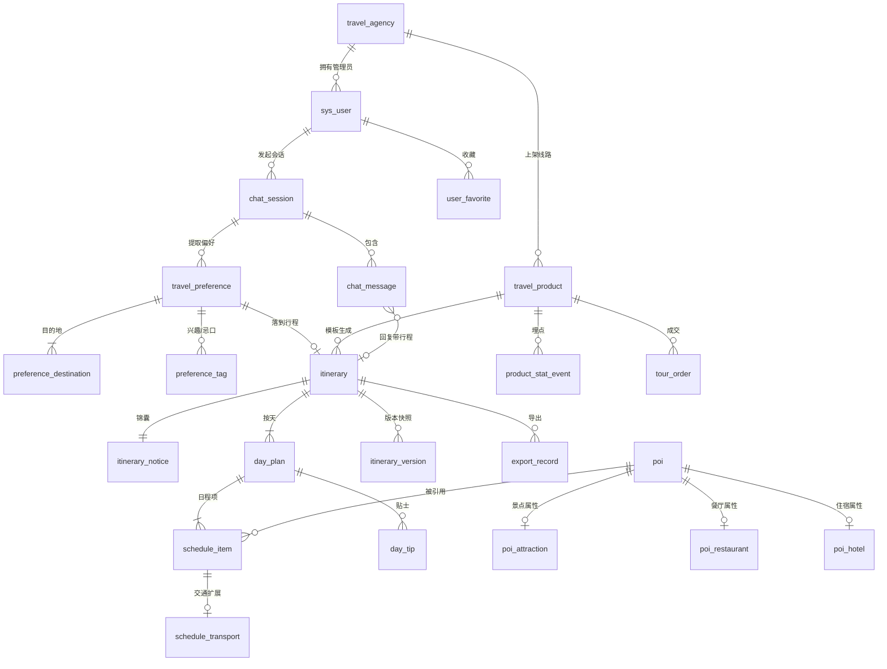

# 旅游规划智能体系统 · 数据库设计说明

> 版本 v1.0 ｜ 2026-10-23 ｜ 数据库 MySQL 8.0.16+ ｜ 字符集 utf8mb4 / utf8mb4_0900_ai_ci
> 依据《旅游规划智能体系统-需求分析文档 v2.0》第 4 章类图、第 5 章状态机、第 6 章数据字典

## 0. 交付物

| 文件 | 内容 |
| --- | --- |
| `01_schema.sql` | 建库 + 24 张表 + 索引 + 外键 + CHECK 约束（可重复执行） |
| `02_seed.sql` | 演示数据：一条完整行程链路 + B 端产品埋点 + Mock 降级日志 |
| `03_sample_queries.sql` | 11 条业务查询，覆盖 AC1–AC4 与前端渲染所需数据 |
| `数据库设计说明.md` | 本文件：表清单、ER 图、设计决策、落地步骤 |

**规模**：24 张表 / 246 个字段 / 35 个外键 / 28 个 CHECK 约束。已在本机 MySQL 8.0.42 上完整执行通过，种子数据校验全部「一致」。

---

## 1. 设计主线

需求文档第 4 章的类图是设计的主干，落库时按「一个类 → 一张表」起步，再处理三类映射难题：

1. **组合关系**：`TravelPlanItinerary ◆─ DayPlan ◆─ ScheduleItem` → 三级外键 + `ON DELETE CASCADE`，行程删除则日程与日程项一并消失。
2. **继承关系**：`Attraction / Restaurant / Hotel ──▷ POI` → **类表继承**（`poi` 存公共属性，三张子表主键即外键），因为 POI 是被多条行程复用的主数据，专有属性差异大，塞进一张表会产生大量空列。
3. **多值属性**：`destinationCities[] / interests[] / dietaryRestrictions[]` → 拆成 `preference_destination`、`preference_tag` 两张子表，而不是塞 JSON，保证第一范式且可排序、可统计。

在此基础上补充了 7 张需求文档提到但未展开的表：账号与机构（`sys_user`、`travel_agency`）、运营闭环（`travel_product`、`product_stat_event`、`tour_order`）、工程支撑（`itinerary_version`、`tool_call_log`）。

---

## 2. ER 关系总览



`product_stat_event.order_id` 指向 `tour_order`，`user_favorite.target_id` 为多态关联，二者不加外键（见 §5 第 9 条）。

---

## 3. 表清单

### 3.1 机构与账号域

| 表名 | 中文 | 字段 | 说明 |
| --- | --- | --- | --- |
| `travel_agency` | 旅行社 | 8 | B 端租户，线路产品归属主体 |
| `sys_user` | 用户 | 13 | 游客与管理员共用，`role` 区分；ADMIN 必须归属机构（CHECK） |
| `user_favorite` | 收藏夹 | 5 | 对应探索页「大家的收藏夹」 |

### 3.2 对话域

| 表名 | 中文 | 字段 | 说明 |
| --- | --- | --- | --- |
| `chat_session` | 会话 | 8 | 一次规划含多轮追问，故独立成表 |
| `chat_message` | 消息 | 9 | 保留 AI 原文、token 数、`associatedItinerary` |

### 3.3 POI 主数据域

| 表名 | 中文 | 字段 | 说明 |
| --- | --- | --- | --- |
| `poi` | 兴趣点 | 18 | 公共属性 + 经纬度 `(9,6)` + 数据来源 + 上下架状态 |
| `poi_attraction` | 景点 | 6 | 门票、建议时长、预约须知 |
| `poi_restaurant` | 餐厅 | 6 | 人均、招牌菜、菜系 |
| `poi_hotel` | 住宿 | 7 | 星级、每晚价、近地铁、特色标签 |

### 3.4 行程域（核心）

| 表名 | 中文 | 字段 | 说明 |
| --- | --- | --- | --- |
| `itinerary` | 行程单 | 26 | 7 态状态机、version、预算总额 + 五分解项、`is_estimated` |
| `itinerary_notice` | 行程锦囊 | 9 | 1:1 垂直拆分：天气/着装/证件/防坑/紧急联络 |
| `travel_preference` | 出行偏好 | 16 | LLM 提取结果 + 原始一句话，可追溯 |
| `preference_destination` | 目的地明细 | 4 | 有序多城市 |
| `preference_tag` | 兴趣/忌口 | 4 | `tag_type` 区分两类标签 |
| `day_plan` | 日程 | 10 | `UNIQUE(itinerary_id, day_index)` 保证天序不重复 |
| `day_tip` | 每日贴士 | 4 | 有序贴士 |
| `schedule_item` | 日程项 | 18 | 四类型统一存储：时段、类型、费用、`is_estimated`、POI 引用 |
| `schedule_transport` | 交通段 | 7 | 1:1 扩展：跨城/市内、方式、起讫、耗时、换乘提示 |
| `itinerary_version` | 版本快照 | 9 | `(itinerary_id, version)` 幂等键，JSON 全量快照 |
| `export_record` | 导出记录 | 8 | 格式、导出时版本、内容快照 |

### 3.5 B 端运营域

| 表名 | 中文 | 字段 | 说明 |
| --- | --- | --- | --- |
| `travel_product` | 线路产品 | 19 | 3 态上下架；`is_active`、`conversion_rate` 为派生列 |
| `product_stat_event` | 埋点事件 | 7 | 明细事实表：浏览/生成/下单 |
| `tour_order` | 订单 | 13 | 转化率「下单数」来源 |

### 3.6 可观测性

| 表名 | 中文 | 字段 | 说明 |
| --- | --- | --- | --- |
| `tool_call_log` | 工具调用日志 | 12 | 五大工具、状态、重试次数、is_mock、延迟 |

---

## 4. 两张核心表的完整数据字典

### 4.1 `itinerary`（行程单）

| 字段 | 类型 | 约束 | 说明 | 来源 |
| --- | --- | --- | --- | --- |
| `id` | BIGINT UNSIGNED | PK, AI | 内部主键，供外键关联 | 系统 |
| `itinerary_no` | CHAR(26) ascii_bin | UNIQUE, NOT NULL | 对外业务编号（ULID），对应 `itineraryId` | 系统生成 |
| `user_id` | BIGINT UNSIGNED | FK→sys_user, NULL | NULL = 未登录体验行程 | 系统 |
| `session_id` | BIGINT UNSIGNED | FK→chat_session | 来源会话 | 系统 |
| `product_id` | BIGINT UNSIGNED | FK→travel_product, NULL | 模板生成时记录 | 系统 |
| `title` | VARCHAR(100) | NOT NULL | `planTitle` | LLM |
| `summary` | VARCHAR(500) | NULL | `summaryDescription` | LLM |
| `status` | ENUM(7 值) | DEFAULT 'DRAFT' | 只能按 5.1 状态表迁移 | 系统 |
| `version` | INT UNSIGNED | CHECK ≥1 | 每次优化 +1，只增不减 | 系统 |
| `days_count` / `nights_count` | TINYINT UNSIGNED | CHECK 1–30 / ≥0 | 天数晚数 | 偏好 |
| `start_date` / `end_date` | DATE | NULL | 出发与结束日期 | LLM/系统 |
| `total_budget_rmb` | DECIMAL(12,2) | CHECK > 0 | 预算总额 | 偏好 |
| `budget_transportation_rmb` | DECIMAL(12,2) | CHECK ≥0 | 默认总额 × 30% | 系统计算 |
| `budget_accommodation_rmb` | DECIMAL(12,2) | CHECK ≥0 | 默认总额 × 35% | 系统计算 |
| `budget_admission_rmb` | DECIMAL(12,2) | CHECK ≥0 | 默认总额 × 15% | 系统计算 |
| `budget_meals_rmb` | DECIMAL(12,2) | CHECK ≥0 | 默认总额 × 15% | 系统计算 |
| `budget_reserve_rmb` | DECIMAL(12,2) | CHECK ≥0 | 默认总额 × 5% | 系统计算 |
| `is_estimated` | TINYINT(1) | DEFAULT 0 | 含 Mock 数据时置 1（AC3） | 系统 |
| `fail_reason` | VARCHAR(255) | NULL | 生成失败回退 DRAFT 时记录 | 系统 |
| `confirmed_at` / `exported_at` / `archived_at` | DATETIME | NULL | 状态迁移时间戳，便于统计停留时长 | 系统 |

表级约束 `chk_itin_budget_ceiling`：五个分项之和 ≤ `total_budget_rmb × 1.05`，把「预算红线」从应用层搬到数据库层。

### 4.2 `schedule_item`（日程项）

| 字段 | 类型 | 约束 | 说明 |
| --- | --- | --- | --- |
| `day_plan_id` | BIGINT UNSIGNED | FK→day_plan, CASCADE | 所属日程 |
| `time_slot` | ENUM('MORNING','AFTERNOON','EVENING') | NOT NULL | 与 `start_time` 的时段区间一致 |
| `item_type` | ENUM('ATTRACTION','MEAL','TRANSPORT','HOTEL') | NOT NULL | 4 值收口，与数据字典红线一致 |
| `seq_no` | TINYINT UNSIGNED | 与 day+slot 组成唯一键 | 同时段排序 |
| `start_time` / `end_time` | TIME | NULL | 具体时刻 |
| `poi_id` | BIGINT UNSIGNED | FK→poi, NULL | 非交通项必填（CHECK `chk_item_poi_required`） |
| `duration_hours` | DECIMAL(3,1) | NULL | 停留/耗时 |
| `nights` | TINYINT UNSIGNED | NULL | 仅住宿项使用 |
| `meal_type` | ENUM('BREAKFAST','LUNCH','DINNER') | NULL | 仅餐饮项使用 |
| `estimated_cost_rmb` | DECIMAL(12,2) | DEFAULT 0 | 预估费用，`is_estimated=1` 时前端加「约」 |
| `is_estimated` | TINYINT(1) | DEFAULT 0 | 逐条标记，行程级再汇总 |
| `booking_url` | VARCHAR(512) | NULL | 预订链接 |
| `highlight_reason` | VARCHAR(255) | NULL | 推荐/顺路理由，答辩时可讲「为什么这样排」 |

---

## 5. 关键设计决策

**① 行程单用「双主键」：内部 `id` + 对外 `itinerary_no`（ULID）**
内部关联统一 `BIGINT` 自增，JOIN 快、外键类型统一；对外暴露 26 位 ULID，满足 `itineraryId: string` 的接口契约，且不可枚举、可离线生成，支持「`itineraryId + version` 幂等」的非功能需求。

**② 预算拆分成列，不建明细表**
五个分项由业务规则固定（30/35/15/15/5），是**同一生命周期的值对象**而非独立实体；用列可以直接写 `CHECK` 校验总和，避免多一次 JOIN。若将来变成「按天按项」预算，再拆 `itinerary_budget_item` 也不迟。

**③ POI 用类表继承，日程项用单表**
`poi` 三类子表的专有字段差异大（门票 vs 人均 vs 每晚价），且 POI 是被复用的主数据，故拆子表；`schedule_item` 只有 `meal_type`、`nights`、`duration_hours` 三个判别字段，且几乎总是一次性查询整天数据，故单表存放、交通专有字段（起讫/方式/耗时）再 1:1 拆到 `schedule_transport`，避免主表出现 6 个长期为 NULL 的列。

**④ 多值属性一律拆子表**
`destinationCities[]`、`interests[]`、`dietaryRestrictions[]`、`signatureDishes[]` 若塞 JSON，则无法建唯一索引、无法按标签统计、也不满足 1NF。取舍结果：*需要排序或统计的拆表*（目的地、标签），*纯展示的留 JSON*（招牌菜、酒店特色、防坑提示），并在文档中标注理由。

**⑤ 「锦囊」1:1 垂直拆分**
`essentialKitAndNotices` 有 8 个字段，只在详情页/导出时读，拆表后 `itinerary` 主表保持在 26 列，列表页扫描更快。

**⑥ 状态用 ENUM 而非字典表**
7 个状态、3 个时段、4 种项类型都是**强收口**的有限集，ENUM 自带校验且省一次 JOIN，符合「枚举禁止自由文本入库」的红线。代价是新增枚举要 `ALTER`，但状态机本身受需求约束，变动成本可接受。

**⑦ 转换率与上架状态用派生列**
`is_active` = `status='ON_SALE'`，`conversion_rate` = `ROUND(order_count/visitor_count,4)`，均为 `STORED GENERATED`。既兼容前端布尔字段 `isActive`，又从根上避免「人工写入的转化率与计数不一致」——AC4 要求「只读统计字段」，库层直接保证。

**⑧ 埋点明细 + 汇总冗余并存**
`product_stat_event` 是事实，`travel_product` 上三个计数是冗余汇总（看板首屏 ≤2s 不能每次 COUNT）。Q6 提供了对账 SQL，两者不一致立即告警。

**⑨ 多态关联不加外键**
`user_favorite(target_type, target_id)` 与 `product_stat_event.order_id` 无法用单一外键约束三类目标。这是**有意为之**的取舍：由应用层 + 定时校验任务保证一致性，换来收藏功能可扩展到任意实体；报告中可作为「反范式点」讨论。

**⑩ POI 只下架、不物理删除**
`schema_item.poi_id` 若用 `ON DELETE SET NULL`，历史行程会丢失「这站到底去了哪」；若用 `RESTRICT`，则 POI 无法清理。最终方案：`poi.status` 做软删除 + 外键 `NO ACTION`，历史行程永远可回溯。

**⑪ 版本快照表**
`version` 只增不减，但主表只保留当前态。`itinerary_version.snapshot` 存全量 JSON + `affected_day_index`，支撑三件事：AC2「只有第 2 天变了」的差异证明、优化历史审计、失败回滚。

> 注：`sys_user.agency_id` 与 `schedule_item.poi_id` 因参与了 CHECK 约束，MySQL 8 不允许其外键再带级联动作（错误 3823），故统一使用 `NO ACTION`（等效 RESTRICT），已在 SQL 注释中标注。

---

## 6. 枚举字典与前后端映射

| 字段 | 库内枚举 | 后端 / 前端取值 | 备注 |
| --- | --- | --- | --- |
| `itinerary.status` | DRAFT/PLANNING/PENDING_CONFIRM/OPTIMIZING/CONFIRMED/EXPORTED/ARCHIVED | 同名 | 与 5.1 状态表 1:1 |
| `schedule_item.time_slot` | MORNING/AFTERNOON/EVENING | `morning/afternoon/evening` | 转大写入库 |
| `schedule_item.item_type` | ATTRACTION/MEAL/TRANSPORT/HOTEL | `attraction/meal/transport/hotel` | 前端 `category='notice'` 不入库，映射到 `day_tip` |
| `schedule_item.meal_type` | BREAKFAST/LUNCH/DINNER | `breakfast/lunch/dinner` | |
| `schedule_transport.transport_mode` | HSR/FLIGHT/SELF_DRIVING/METRO/TAXI/CHARTER_BUS | `high_speed_rail/flight/self_driving/metro/taxi/charter_bus` | `charter_bus` 对应 `charter_bus`（包车） |
| `schedule_transport.segment_type` | INTERCITY/LOCAL | `intercity/local` | |
| `travel_preference.pace` | SLOW/NORMAL/INTENSIVE | 由「慢一点/正常/紧凑」提取 | |
| `travel_preference.travel_style` | LEISURE/FAMILY/COUPLE/HIKING/PHOTOGRAPHY/FOODIE | 同名 | 对应前端 `TravelStyle` |
| `travel_preference.hotel_preference` | NEAR_ATTRACTION/NEAR_METRO/COST_FIRST | 同名 | |
| `travel_product.status` | DRAFT/ON_SALE/OFF_SALE | `isActive` 布尔 | 5.3 状态机 |
| `chat_message.sender` | USER/ASSISTANT/SYSTEM | `user/agent` | 前端 `agent` → `ASSISTANT` |
| `export_record.export_format` | WECHAT_LONG_TEXT/PRINT | 同名 | |

---

## 7. 验收标准 → 表结构映射

| 验收标准 | 依赖的表 / 约束 | 验证 SQL |
| --- | --- | --- |
| **AC1** 60s 出 4 天时间轴，预算五项和 ≤ 8000×1.05 | `itinerary` 五分解项 + `chk_itin_budget_ceiling`；`day_plan` 唯一键保证每天一行；`schedule_item` 三段时段 | Q2、Q3、Q1 |
| **AC2** 「第 2 天换杜甫草堂」，只有第 2 天变，version 1→2 | `itinerary_version`(itinerary_id, version) + `affected_day_index` + snapshot JSON；`day_plan` 唯一键定位受影响天 | Q4 |
| **AC3** 断网时仍能生成，字段带「约」，is_estimated=true | `tool_call_log.retry_count/is_mock` ↔ `schedule_item.is_estimated` ↔ `itinerary.is_estimated` 三级链路 | Q5 |
| **AC4** 转化率=下单/访客，保留 4 位小数，可下钻 | `travel_product.conversion_rate` 派生列；`product_stat_event` 明细；`tour_order` | Q6、Q7 |
| UC17 导出脱敏 | `export_record.content` 快照 + 应用层脱敏规则 | Q11 |

---

## 8. 索引与性能

| 索引 | 支撑场景 |
| --- | --- |
| `itinerary(user_id, status, created_at)` | 我的行程列表（按状态筛选 + 倒序） |
| `itinerary(status, updated_at)` | 状态机巡检（Q10 卡单扫描） |
| `day_plan UNIQUE(itinerary_id, day_index)` | 按天读取 + 防止重排产生重复天 |
| `schedule_item UNIQUE(day_plan_id, time_slot, seq_no)` | 整天时间轴一次性有序取出，避免应用层排序 |
| `poi(city_name, poi_type)` | generatePlan 按城市 + 类型批量取候选 POI |
| `poi(latitude, longitude)` | 动线顺路计算的范围预筛（可升级为 SPATIAL INDEX） |
| `travel_product(status, visitor_count)` | 游客端「热门线路」列表 |
| `product_stat_event(product_id, event_type, occurred_at)` | 看板按线路 + 事件 + 时间窗口聚合 |
| `chat_message(session_id, created_at)` | 会话消息分页 |
| `tool_call_log(created_at)` | 延迟 / Mock 占比的时间序监控 |

金额全为 `DECIMAL`，统计类派生列已 `STORED` 并建索引，看板查询无需实时聚合明细。

---

## 9. 落地步骤

```bash
# 1) 建库建表（可重复执行，会自动 DROP 旧表）
mysql -u root -p < database/01_schema.sql

# 2) 导入演示数据
mysql -u root -p travel_agent_db < database/02_seed.sql

# 3) 跑业务查询样例
mysql -u root -p travel_agent_db < database/03_sample_queries.sql
```

后端接入（`backend/src/db/pool.ts`，需 `npm i mysql2`）：

```ts
import mysql from 'mysql2/promise';

export const pool = mysql.createPool({
  host: process.env.DB_HOST ?? '127.0.0.1',
  port: Number(process.env.DB_PORT ?? 3306),
  user: process.env.DB_USER,
  password: process.env.DB_PASSWORD,
  database: process.env.DB_NAME ?? 'travel_agent_db',
  charset: 'utf8mb4',
  connectionLimit: 10,
  // 金额以字符串返回，避免 JS 浮点误差（对应「金额禁止 float」红线）
  decimalNumbers: false,
});
```

`.env` 增加：`DB_HOST / DB_PORT / DB_USER / DB_PASSWORD / DB_NAME`，与现有 `LLM_API_KEY` 一样只留在服务端。

对接时与现有代码的三处改动点：
1. `chatRouter` 的 `/plan`：把 `planner.generatePlan()` 的返回写入 `itinerary + day_plan + schedule_item`，返回前生成 `itinerary_no`。
2. `itineraryRouter` 的 `/optimize`：先校验 `status='PENDING_CONFIRM'`，事务内 `version+1` + 写 `itinerary_version` + 局部替换 `schedule_item`；预算超 `×1.05` 直接回滚。
3. `adminRouter`：`mockProducts` 数组替换为 `travel_product` 查询；`/analytics` 改用 Q6 的聚合 SQL。

---

## 10. 可扩展点

- **新增工具**（签证/保险）：`tool_call_log.tool_name` 扩一个枚举值，业务表无需改动——与「工具层面向接口扩展」的架构原则一致。
- **POI 空间检索**：`poi` 增加 `POINT SRID 4326` 生成列 + `SPATIAL INDEX`，可把 Q9 的 O(n²) 两两比较换成「半径内候选集」。
- **多租户隔离**：所有 B 端查询带 `agency_id` 条件；若租户量级增大，可给 `travel_product`、`tour_order` 增加 `agency_id` 冗余列并建组合索引。
- **行程协同编辑**：`itinerary_version` 已具备乐观锁基础，可加 `lock_version` 字段做并发控制。
