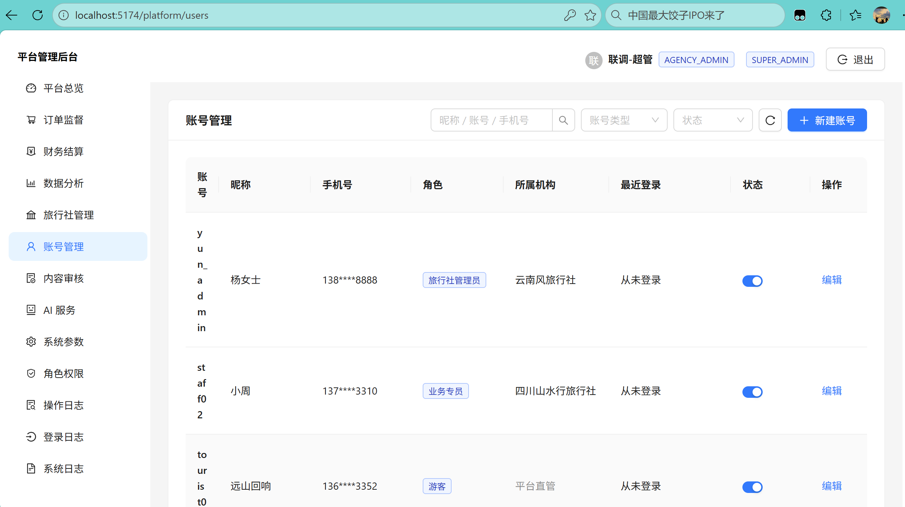
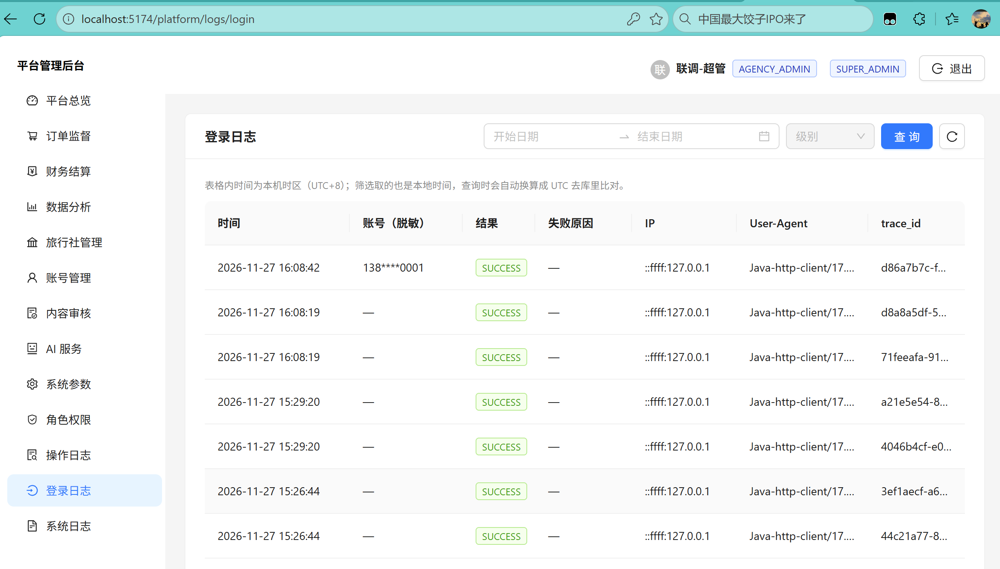
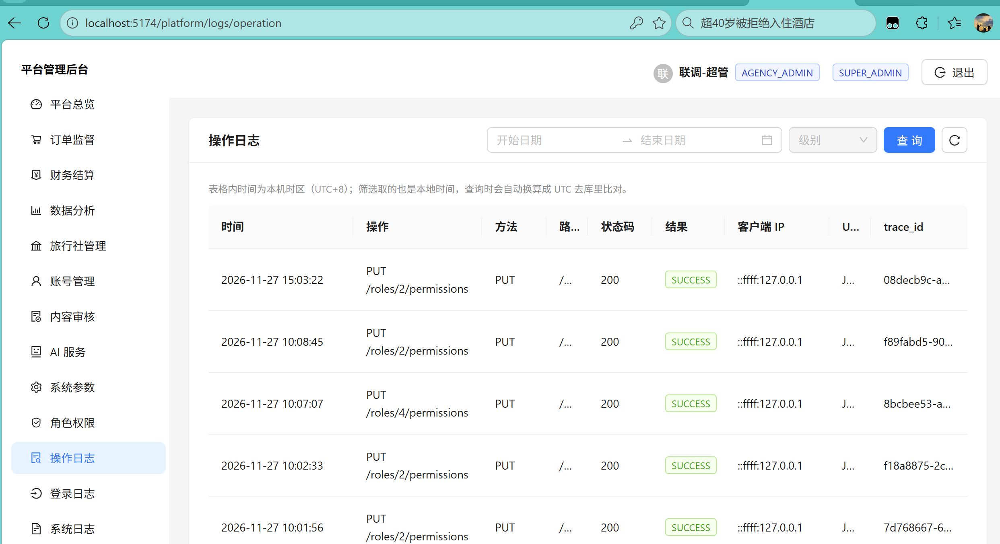
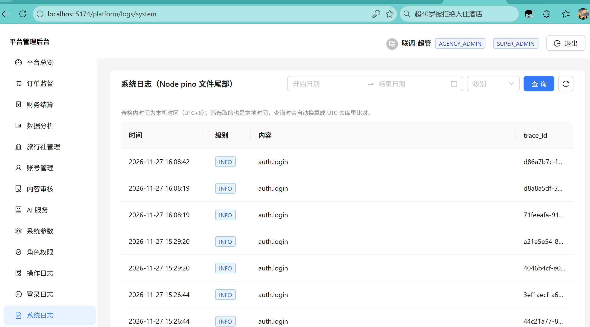

# 组员2 · 工作笔记

> 记录 S3 实施过程中的验证证据与结论，供验收与答辩引用。实施教程见同目录《组员2-S3实施教程.md》。

## 脱敏自检（第 5 步，2026-11-27 实测）

> 出口判据："抓一条日志行，肉眼看不到完整手机号"。
> 以下证据全部来自**真实接口响应**（经 Java BFF → Node → 数据库全链路），比页面截图更接近源头：
> 页面上看到的是渲染结果，JSON 是前端能拿到的全部数据——JSON 里没有，页面就不可能有。

| # | 自检项 | 证据（命令 + 实际输出） | 结论 |
|---|---|---|---|
| 1 | 账号管理页手机号脱敏 | `GET /api/platform/users?page=1&size=5` → `138****8888`、`137****3310`、`136****3352`、`137****8433`、`135****0917` | ✅ 全部 `138****` 形态，响应里无完整手机号 |
| 2 | 登录日志脱敏 | `GET /api/platform/logs?type=login&page=1&size=5` → `login_name` 均为 `138****0001` 或 null（该行为成功登录但未落账号名的旧数据） | ✅ 无完整手机号 |
| 3 | 操作日志不落请求体 | 同接口返回行字段只有 `id, operator_id, action, request_method, request_path, status_code, result, client_ip, ua, trace_id, created_at` 共 11 个元数据字段；正则扫 `password|token|request_body|params"` = **0 命中** | ✅ 只有方法/路径/状态码，没有密码、token、请求参数 |
| 4 | 系统日志无敏感头 | `GET /api/platform/logs?type=system&page=1&size=100` 全文扫 `Authorization / X-Signature / X-Nonce / Bearer / password / jwt` → **全部 0 命中** | ✅ S1 的 pino redact 确实生效 |
| 5 | 响应体复核（= F12 Network 看到的同一份数据） | 自检 1/2/4 的 curl 响应即前端拿到的原始 JSON，脱敏发生在**写库前**（`login_name` 落库时已打码），不是前端用 CSS 藏的 | ✅ "后端就没存"而非"前端藏起来" |
| 6 | 浏览器无令牌 | Cookie jar 全量内容：`JSESSIONID`（**HttpOnly**）+ `XSRF-TOKEN` 两条；对 `/api/platform/logs` 的请求头中 `Authorization` / `X-Signature` / `X-Nonce` 均**不存在** | ✅ 幂等键与 HMAC 由 BFF 服务端补齐，浏览器不接触任何令牌 |

### 页面截图证据（4 张，2026-11-27 实测，存本目录 `体检截图/`）

> 页面在 `http://localhost:5174`，超管登录。判定口径仍以上表 JSON 证据为准，
> 截图是给答辩看的渲染结果；四张图的时间列均已按本机时区显示（如 `2026-11-27 16:08:42`）。

**截图 1 · 账号管理页（对应自检 1）** — `体检截图/10-users-masked.png`

手机号列：`138****8888`、`137****3310`、`136****3352` —— 肉眼看不到完整号码。

**截图 2 · 登录日志（对应自检 2）** — `体检截图/11-logs-login.png`

「账号（脱敏）」列：`138****0001`，无完整号；结果 `SUCCESS`、失败原因 `—`。

**截图 3 · 操作日志（对应自检 3）** — `体检截图/12-logs-operation.png`

只有 时间 / 操作 / 方法 / 路径 / 状态码 / 结果 / IP / UA / trace_id —— 无请求体、无密码、无 token。

**截图 4 · 系统日志（对应自检 4）** — `体检截图/13-logs-system.png`

内容为 `auth.login` 事件名，级别 `INFO`；无 Authorization / Bearer / 密码等敏感头或字段。

## 硬编码检查（分工第 6 项）

`grep -rn "'ADMIN'" java-web/agency-web/src` → **2 处命中，均为合法数据枚举值，不是权限判断**：

| 位置 | 内容 | 判定 |
|---|---|---|
| `lib/types.ts:202` | `user_type: 'TOURIST' \| 'ADMIN'` | 后端字段枚举的类型声明（`platformRouter.ts:257` 的 `z.enum(['TOURIST','ADMIN'])`），照抄后端契约 |
| `pages/platform/UsersPage.tsx:190` | 筛选下拉 `{ value: 'ADMIN', label: '后台账号' }` | 该查询参数的合法取值，传给 Node 做 `u.role` 过滤 |

另：`lib/auth.tsx:52` 的 `me.roles?.includes('SUPER_ADMIN')` 是 **S2 既有交付物**（超管全通过快捷通道，与 Node 侧 requireAction 对超管的放行口径一致），按 R3 纪律不改动、只登记。

**S3 新增代码中角色判断硬编码 = 0 处**；页面可见性全部走 `can(权限码)`（`AppLayout` / `Permission` / `RequirePlatform`）。

## 待办

- [x] 4 张脱敏截图（已插入上文，图片存 `体检截图/10~13-*.png`）
- [ ] `analytics:platform:query` 补库 SQL 由组员3 执行（问题单 #1）
